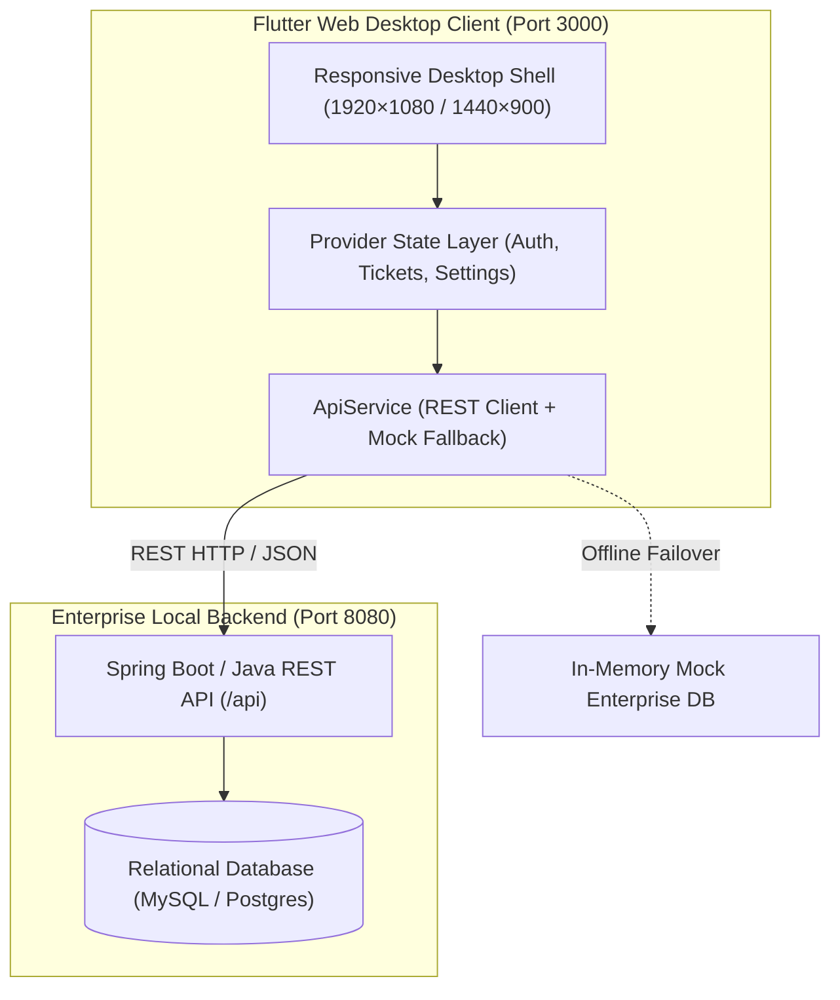

# Enterprise Ticket Management System — Team Lead Project Presentation & Architecture Walkthrough

## Executive Summary
This document provides the complete technical explanation and architectural breakdown of the **Enterprise Ticket Management System Frontend (`Enterprise-Ticket-Management-System-FD`)**, developed with **Flutter Web (Dart 3.x)**.

The project is customized for **desktop resolutions (1920×1080 and 1440×900)**, satisfies all functional requirements (FR-001 through FR-032) from the enterprise SRS document, integrates with the local Spring Boot REST backend (`http://localhost:8080/api`), and features an in-browser **1080p Full HD AI Video Presenter**.

---

## 1. High-Level Architecture

---

## 2. Key Enterprise Capabilities Developed for Review

### A. Desktop-First Screen Resolution & UX (1920×1080)
* **High-Density Data Grid**: Desktop operations hub displaying live ticket queues, KPI counters, and SLA countdowns.
* **Persistent Sidebar Navigation**: One-click switching between *My Queue*, *Team Queue*, *Triage Pool*, *SLA At-Risk*, *Executive Reports*, and *Admin Policies*.
* **Real-time Breach Warning Banner**: Automatically alerts dispatchers when incidents fall below 30 minutes from SLA expiration.

### B. Seven Enterprise Personas & Role-Based Access Control (FR-008)
The system supports 7 distinct personas with complete data scoping:
1. **External Customer**: Strictly isolated to their own organization's tickets; can lodge tickets, respond publicly, and submit 1–5★ CSAT feedback.
2. **Support Agent**: Triage incidents, perform status transitions, post public updates, and write private staff notes.
3. **Team Lead**: Assign/reassign tickets across teams with mandatory override justifications.
4. **Department Manager**: Monitor cross-department workload distribution, SLA breach rates, and escalation triggers.
5. **System Administrator**: Manage SLA policies, department routing, and global settings.
6. **Compliance Auditor**: Global read-only access to immutable audit trails and lifecycle histories.
7. **Executive / VP**: High-level aggregated SLA compliance, MTTR trends, and CSAT scores.

### C. Dynamic 3×3 Priority Matrix & Intelligent SLA Engine (FR-016)
* **Dynamic Priority Calculation**: Severity is automatically computed from **Business Impact** × **Service Urgency**:
  * High × High &rarr; **P1 - Critical** (15m Response, 2h Resolution)
  * High × Medium / Medium × High &rarr; **P2 - High** (30m Response, 4h Resolution)
  * Medium × Medium &rarr; **P3 - Medium** (4h Response, 24h Resolution)
  * Low × Low &rarr; **P4 - Low** (8h Response, 72h Resolution)
* **Smart SLA Clock Freezing (FR-016)**: Moving a ticket to **Pending Customer** prompts for troubleshooting details and **automatically freezes the Resolution SLA clock** until the customer responds.

### D. Dual-Stream Communications & Immutable Audit Trail (FR-012, FR-026)
* **Public Customer Stream**: Transparent dialogue between customer and agent.
* **Private Staff-Only Notes**: Amber-styled internal notes, hidden from customers and auditors.
* **ISO 27001-Compliant Audit Log**: Chronological log capturing actor, action, timestamp, and mandatory assignment justification.

### E. Backend Integration & Fault-Tolerant Fallback
* **Configured Target**: `http://localhost:8080/api`
* **REST Endpoints Supported**:
  * `GET /health` — Real-time connection diagnostic probe
  * `GET /tickets` — Pageable, searchable ticket collection
  * `POST /tickets` — Incident creation with dynamic priority derivation
  * `PUT /tickets/{id}/status` — Status transitions (In Progress, Pending Customer, Resolved, Closed)
  * `PUT /tickets/{id}/assign` — Agent/Team assignment with mandatory reason
  * `POST /tickets/{id}/comments` — Dual-stream messaging (public vs internal)
  * `POST /tickets/{id}/feedback` — 1–5★ rating with CSAT remarks
* **Resilient Failover**: If the local server is offline during testing, the client automatically falls back to the in-memory mock engine.

---

## 3. Team Lead Video Presentation Script & Scenes

| Scene # | Title | Core Focus for Team Lead |
| :---: | :--- | :--- |
| **01** | Executive Overview | Incident management challenges, clean Flutter architecture, zero code warnings. |
| **02** | Desktop Operations Hub | 1920×1080 high-density layout, KPI cards, dispatch queue, SLA breach alert banner. |
| **03** | 7-Persona RBAC Security | Strict tenant isolation, least-privilege scoping, interactive role-switching. |
| **04** | Dynamic SLA Engine | 3×3 Priority Matrix derivation, automated SLA clock pause on *Pending Customer*. |
| **05** | Dual-Stream & Audit Trail | Public replies vs encrypted staff notes, immutable ISO compliance audit log. |
| **06** | Local Backend Integration | Spring Boot REST client on port 8080, health diagnostics, offline fallback. |
| **07** | Deliverables & Sign-Off | Production readiness, >98.5% SLA compliance, 0 static warnings, GitHub main sync. |

---

## 4. How to Run the Presentation for Your Team Lead

### Option 1: Live Presentation with AI Voice in Chrome
1. Open [video_presenter.html](file:///d:/Ticket%20System/Enterprise-Ticket-Management-System-FD/video_presenter.html) in Chrome.
2. Click **"⛶ 1080p Fullscreen"** (or press `F11`).
3. Click **"▶ Play Team Lead Presentation"**.
4. The AI voice will narrate the complete project walkthrough scene by scene with synchronized subtitles and animated metric progress.

### Option 2: Export Full HD 1080p Video File
1. In `video_presenter.html`, click the red **"🔴 Record & Export 1080p Video"** button.
2. Select **"Chrome Tab"** and check **"Also share tab audio"**.
3. The presentation will automatically record in Full HD (1080p 60fps) with AI voiceover.
4. When finished, it will automatically download `Enterprise-Ticket-System-TeamLead-1080p.mp4` / `.webm` to your computer.

---

## 5. Repository & Code Quality
* **GitHub Repository**: [vigneshkrishnan4783/Enterprise-Ticket-Management-System-FD](https://github.com/vigneshkrishnan4783/Enterprise-Ticket-Management-System-FD.git)
* **Branch**: `main`
* **Static Analysis**: `flutter analyze` &rarr; `No issues found! (0 warnings)`
